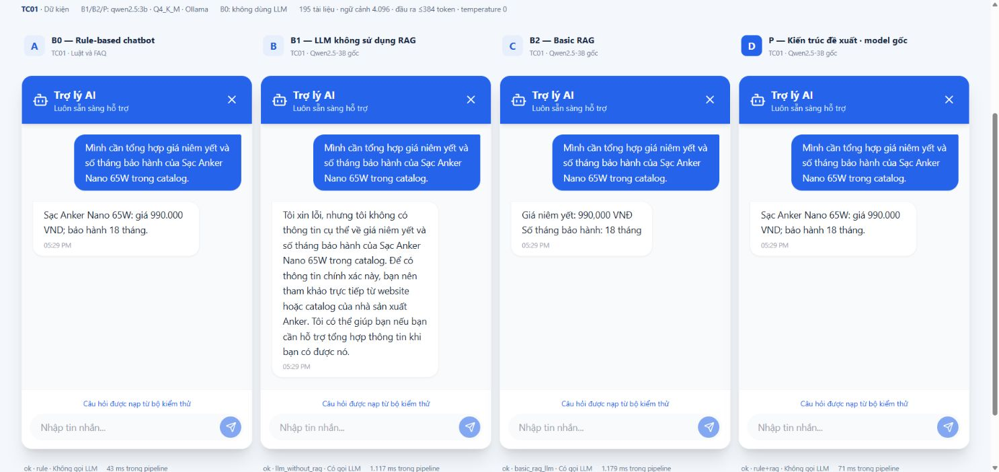

# TechCare Electronics — website và chatbot chăm sóc khách hàng

Website thiết bị công nghệ với chatbot tiếng Việt chạy LLM local + RAG, lịch sử hội thoại, ticket hỗ trợ và quản trị FAQ/ticket. **Giá, sản phẩm và chính sách là dữ liệu mô phỏng nghiên cứu**, không phải cam kết bán hàng.

> Bản demo phục vụ quay video và báo cáo nhóm ngày 20/10/2026. Đã sửa bước xét bằng chứng kỹ thuật và transport của website; kiểm thử API với model thật có kết quả trong [báo cáo điều tra](docs/LLM_RAG_INVESTIGATION_20261020.md). Xem [ghi chú demo và lệnh quay video](docs/DEMO_RELEASE.md). Đây là môi trường thực nghiệm, chưa phải bản triển khai production.



*Ảnh local thật ngày 16/10/2026. B1/B2/P trong ảnh dùng base 3B của nghiên cứu; website mặc định dùng model demo 3B đã fine-tune.*

## Kiến trúc và cấu trúc

React/Vite → FastAPI → nghiệp vụ hội thoại → luật/catalog/FAQ hoặc hybrid retrieval → prompt + LLM → kiểm tra dữ kiện → câu trả lời/ticket. SQLAlchemy lưu SQLite mặc định; PostgreSQL tùy chọn.

Model website là Ollama `techcare-support:3b-v1` qua `backend/rag_data/model_profile.json`; embedding `nomic-embed-text`. RAG dùng JSON index, semantic + BM25, KB/catalog/FAQ. Đường website xét thêm bằng chứng phù hợp cho câu hỏi kỹ thuật chung. Luật/FAQ có thể trả lời trước LLM nên không phải mọi câu đều gọi model. Giá/tồn kho là dữ liệu nghiệp vụ, không lấy từ trí nhớ model.

Corpus kỹ thuật chưa đầy đủ: các câu giải thích dual-channel, NVMe hoặc OLED có thể nhận thông báo thiếu tài liệu và ticket. Đây là fallback có chủ đích; không coi danh sách thông số sản phẩm là định nghĩa. Hiệu năng phụ thuộc GPU/CPU, VRAM, độ dài hội thoại và trạng thái model đã nạp; chưa kiểm thử trên laptop RTX 3050.

B1/B2/P trong nghiên cứu khóa **base** `qwen2.5:3b`. P+FT 7B là thử nghiệm bổ sung, không thuộc bốn phương pháp chính.

```text
backend/
  app/                     API, nghiệp vụ, RAG, bảo mật
  rag_data/                KB, FAQ, catalog, prompt, profile, index
  models/techcare-support-3b-v1/   GGUF + adapter LFS, data, license, evidence
  benchmark/               B0/B1/B2/P, ablation, M1–M4, bộ 24 câu
  model_serving/           Server adapter 7B; checkpoint ngoài repo
  training/                Mã tái tạo huấn luyện, môi trường GPU riêng
  tests/                   Unit, integration, regression
frontend/                  Website, chat widget, demo nghiên cứu local
docs/                      Hướng dẫn, bằng chứng, tài liệu lịch sử
BaoCao/                    Các bản Word gốc
install_trained_model.ps1
run_tests.ps1
docker-compose.yml         PostgreSQL tùy chọn
```

## 1. Chuẩn bị Windows và clone

Môi trường kiểm tra release: **Python 3.14.3, Node.js 24.14.0, npm 11.9.0, Git LFS 3.6.1, Ollama 0.40.6**. Vite trong lockfile yêu cầu Node `^20.19.0 || >=22.12.0`. Các phiên bản khác chưa được xác nhận trong lần kiểm thử này.

Cài [Python](https://www.python.org/downloads/windows/), [Node.js](https://nodejs.org/), [Git](https://git-scm.com/download/win), [Git LFS](https://git-lfs.com/) và [Ollama](https://ollama.com/download/windows). Mở Ollama trước khi cài model. Cần dung lượng cho dependencies, GGUF khoảng 1,93 GB, adapter khoảng 120 MB và embedding. Hiệu năng RTX 3050 laptop chưa được đo trong lần release.

```powershell
git lfs install
git clone --branch chatbot-v1 https://github.com/nhuquynh112/NCKH_chatbot.git
Set-Location NCKH_chatbot
git lfs pull
git lfs ls-files
.\install_trained_model.ps1 -VerifyOnly
```

GGUF/safetensors phải là trọng số thật, không phải pointer vài trăm byte. Nếu LFS lỗi quota/quyền truy cập, xử lý với chủ repo; không đẩy trọng số vào Git thông thường. Chưa có link tải thay thế được công bố. Có thể sao chép trực tiếp project đã chạy được nếu giữ đủ file và SHA256 khớp profile.

Nếu PowerShell chặn script, dùng `powershell.exe -NoProfile -ExecutionPolicy Bypass -File .\install_trained_model.ps1` hoặc tương tự cho `run_tests.ps1`; không cần đổi chính sách toàn máy.

## 2. Model và backend

Từ gốc project:

```powershell
.\install_trained_model.ps1
ollama pull nomic-embed-text
ollama list
python -m venv backend\.venv
& .\backend\.venv\Scripts\python.exe -m pip install -r .\backend\requirements.txt
if (-not (Test-Path .\backend\.env)) {
    Copy-Item .\backend\.env.example .\backend\.env
}
```

Installer kiểm tra kích thước/SHA256 rồi import GGUF local; không train hoặc tự thay model. File tạm mặc định ở Temp Windows; có thể truyền `-WorkDir 'E:\TechCareWork'` hoặc `CHATBOT_WORK_DIR`, ngoài project. Không cần tải base 3B để dùng GGUF hoàn chỉnh.

Với clone mới, giữ `DATABASE_URL=sqlite:///./techcare.db`, `ENVIRONMENT=development` và `CHAT_PROVIDER=ollama`. `CHAT_MODEL=qwen2.5:3b` vẫn được profile đổi thành `techcare-support:3b-v1` khi `USE_PROJECT_CHAT_MODEL=true`. Cấu hình tùy chỉnh khác được ưu tiên theo code. Không chép đè `.env` đang có vì có thể nó trỏ tới database thật.

Khởi tạo **database demo mới** và chạy:

```powershell
Set-Location backend
& .\.venv\Scripts\python.exe seed.py
# Chỉ rebuild khi đổi dữ liệu/index hoặc cần tạo lại index:
# & .\.venv\Scripts\python.exe rebuild_rag.py
& .\.venv\Scripts\python.exe -m uvicorn app.main:app --host 127.0.0.1 --port 8000
```

`seed.py` nạp sản phẩm/FAQ khi bảng tương ứng trống; app cũng gọi seed khi `AUTO_SEED=true`. Kiểm tra `DATABASE_URL` trước khi chạy. Rebuild cập nhật tài liệu/index, không train model. Semantic RAG chưa sẵn sàng nếu Ollama/embedding chưa hoạt động, dù câu luật/FAQ vẫn có thể trả lời.

## 3. Frontend và URL

Mở terminal thứ hai tại gốc project:

```powershell
Set-Location frontend
npm.cmd ci
if (-not (Test-Path .\.env)) {
    Copy-Item .\.env.example .\.env
}
npm.cmd run dev -- --host 127.0.0.1 --port 5173 --strictPort
```

| Chức năng | URL |
|---|---|
| Website | http://127.0.0.1:5173/products |
| Hội thoại | http://127.0.0.1:5173/faqs |
| Admin | http://127.0.0.1:5173/admin/login |
| API docs | http://127.0.0.1:8000/docs |
| Health | http://127.0.0.1:8000/health |
| Readiness | http://127.0.0.1:8000/ready |

`/ready` cần có `chat_model: techcare-support:3b-v1` và `ai: ok`. `status: degraded` vẫn trả HTTP 200, phải đọc JSON. Endpoint chưa kiểm tra embedding/index; cần rebuild thành công và thử câu RAG. Một câu FAQ trả được chưa chứng minh LLM hoạt động.

Frontend gọi `http://localhost:8000/api`; đổi bằng `VITE_API_BASE_URL` trước khi chạy Vite. Nếu đổi cổng frontend, cập nhật `CORS_ORIGINS` backend.

### PostgreSQL tùy chọn

SQLite đủ cho demo laptop. Nếu có Docker Compose, từ gốc:

```powershell
$env:POSTGRES_PASSWORD = Read-Host 'Mật khẩu PostgreSQL demo do bạn chọn'
docker compose up -d postgres
Remove-Item Env:POSTGRES_PASSWORD
```

Đặt `DATABASE_URL=postgresql://postgres:<mat-khau-da-chon>@localhost:5432/nckh_chatbot` trong `backend/.env`; URL-encode mật khẩu có ký tự đặc biệt. Chạy seed/backend như trên. Compose chỉ bind loopback; không đổi mật khẩu volume đã tồn tại. Docker chưa được kiểm thử runtime trong lần release này.

## 4. Kiểm thử và đổi model

Từ gốc:

```powershell
.\run_tests.ps1
# Hoặc chọn thư mục ngoài project:
.\run_tests.ps1 -WorkDir "$env:TEMP\TechCareChecks" -EvaluationLabel release
```

Sáu nhóm: backend unit/integration, catalog/API, 32 câu FAQ/RAG, Ollama offline, frontend lint và production build. Mỗi lượt tạo `tests-UTC-UUID`, SQLite tạm và log/phản hồi riêng; không ghi đè báo cáo lịch sử/benchmark. Cần dependencies và Ollama cho nhánh online. Unit test có mock không thay benchmark LLM thật; tỷ lệ đạt luật/FAQ không phải accuracy khách thật.

Chuyển về base 3B trong terminal backend:

```powershell
ollama pull qwen2.5:3b
$env:CHAT_PROVIDER='ollama'
$env:CHAT_MODEL='qwen2.5:3b'
$env:USE_PROJECT_CHAT_MODEL='false'
# Dừng và khởi động lại uvicorn.
```

Về model demo: bỏ override bằng `Remove-Item Env:USE_PROJECT_CHAT_MODEL`, khởi động lại với cấu hình mặc định.

## 5. Nghiên cứu và cập nhật dữ liệu

- [Tái lập trên máy khác](docs/REPRODUCING_RESEARCH.md): bộ 24 câu, B0/B1/B2/P, P+FT và bằng chứng đã đóng gói.
- [Demo chụp ảnh](docs/LOCAL_BENCHMARK_DEMO.md): TC01/11/18/21 và đúng vai trò lịch sử TC21. Cần study gốc/đúng source hash; clone chưa chứa toàn bộ database của lượt chạy cũ. Source hash đã đổi sau bản vá website nên không chạy study cũ trực tiếp bằng code hiện tại; dùng runtime snapshot gốc hoặc tạo study mới, không sửa protocol cũ.
- [Giao thức Chương 5](docs/CHAPTER5_RUNBOOK.md), [benchmark M1–M4](backend/benchmark/README.md), [server 7B](docs/MODELS_AND_BENCHMARK.md).
- [Model 3B, nguồn và tái tạo](backend/models/techcare-support-3b-v1/README.md). Không cài runtime GPU vào FastAPI. Checkpoint/adapter 7B gốc giữ ngoài repo, không bắt buộc cho website.
- [Mục lục tài liệu](docs/README.md), [ghi chú demo hiện tại](docs/DEMO_RELEASE.md), [kiểm tra đóng gói trước bản vá](docs/RELEASE_CHECKS.md).

Admin cập nhật FAQ/ticket qua website. Sau khi duyệt dữ liệu, từ `backend` chạy:

```powershell
& .\.venv\Scripts\python.exe export_rag.py
& .\.venv\Scripts\python.exe rebuild_rag.py
```

Export đọc catalog/FAQ active từ database. `knowledge_base.md` và `faq_curated.json` là nguồn biên tập riêng; `product_verified_specs.json` giữ mức xác minh và URL hãng. `sync_verified_products.py` sửa database, chỉ chạy sau khi duyệt. Khởi động lại backend sau rebuild. Không nhập đáp án test hoặc giá/chính sách của dataset khác vào tri thức TechCare.

## Bảo mật và giấy phép

`admin / admin123` chỉ dùng **demo local**, đúng với Settings. Trước triển khai thật: `ENVIRONMENT=production`, `AUTO_SEED=false`, secret riêng tối thiểu 32 ký tự, mật khẩu admin tối thiểu 12 ký tự, CORS đúng tên miền. Backend kiểm tra các điều kiện này.

Không commit `.env`, database, lịch sử khách hàng, token, cache hoặc log. Giữ [Qwen Research License](backend/models/techcare-support-3b-v1/LICENSE), [giấy phép dữ liệu](backend/models/techcare-support-3b-v1/data/LICENSE), [thông báo nguồn](docs/THIRD_PARTY_NOTICES.md). Nhóm chưa gán giấy phép chung cho toàn bộ mã nguồn. Đường dẫn ổ D trong hồ sơ cũ là provenance, không phải yêu cầu cài đặt.
